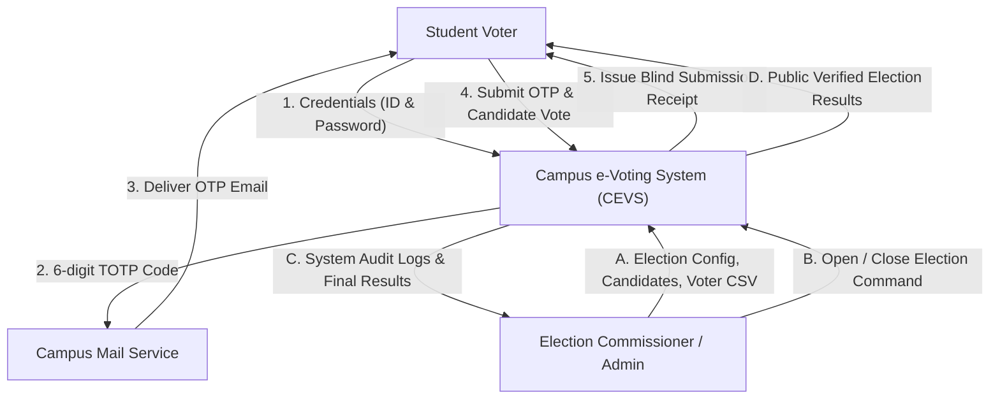
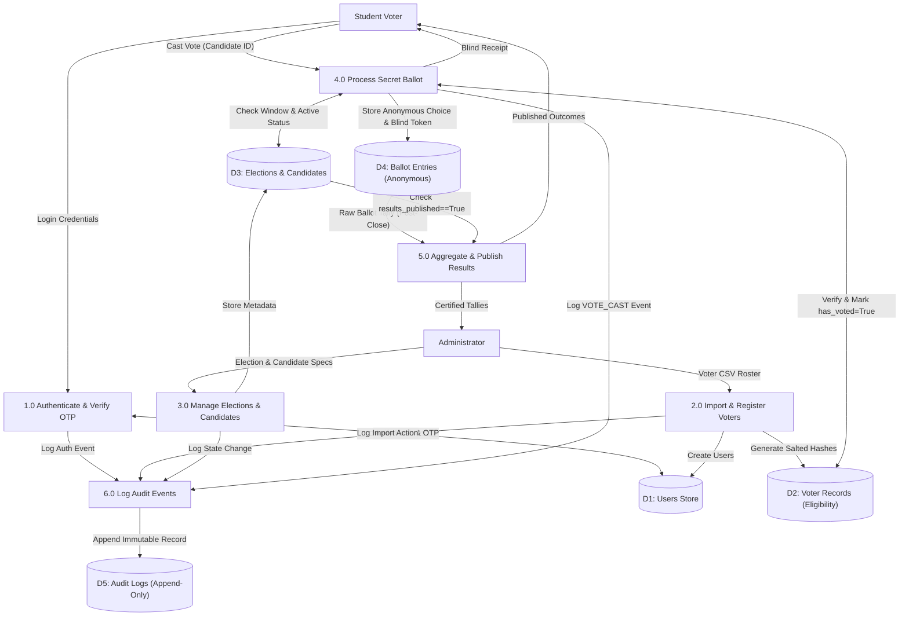
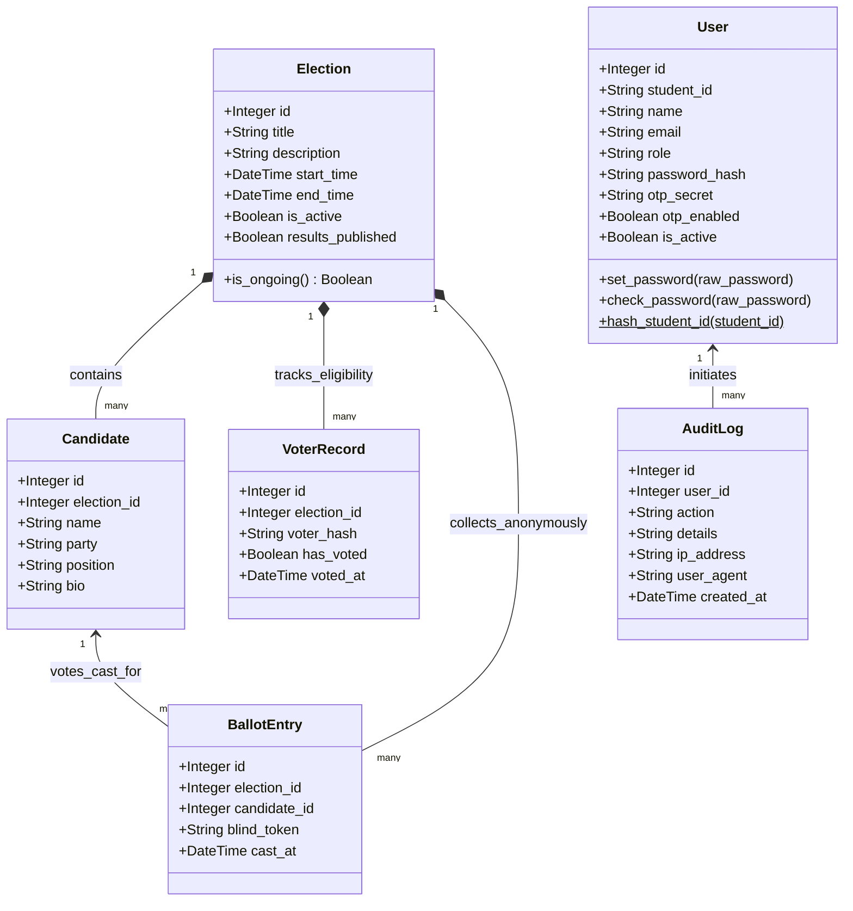
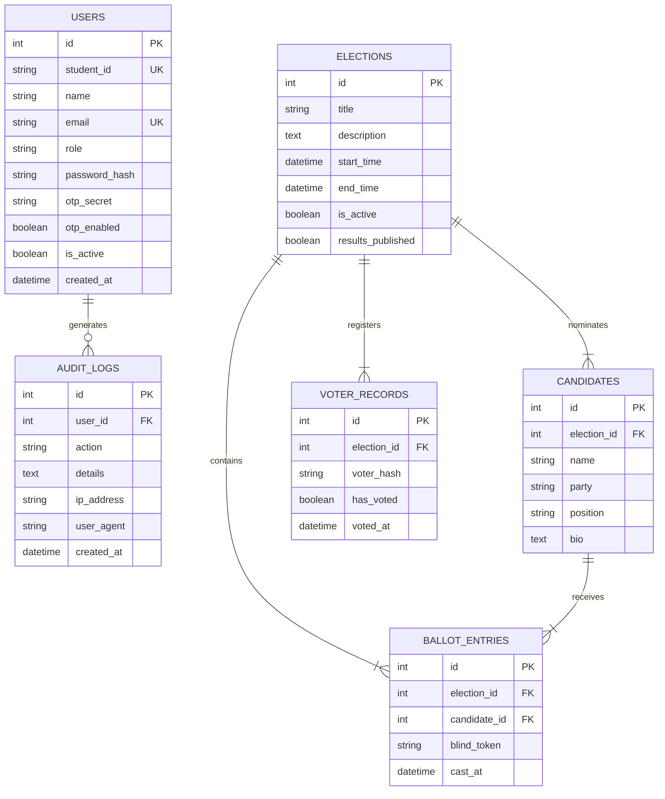

# System Design Document (SDD)
## Campus e-Voting System (CEVS)
**Document Identifier:** CEVS-DOC-DES-04  
**Course:** B.Sc. Computer Science (Major), NEP 2020, Semester 5 — Software Engineering  
**Unit Alignment:** Unit 5 (Architectural Design, DFDs, UML Modeling, Relational Design)  
**Standard:** IEEE Std 1016-2009 (Systems Design — Software Design Descriptions)  
**Version:** 1.0.0 (Release Baseline)  
**Date:** October 2026  

---

## Table of Contents
1. [Introduction](#1-introduction)  
   1.1 [Purpose & Scope](#11-purpose--scope)  
   1.2 [Design Principles](#12-design-principles)  
2. [Architectural Design](#2-architectural-design)  
   2.1 [Tiered Client-Server Architecture](#21-tiered-client-server-architecture)  
   2.2 [Component Decomposition & Module Decoupling](#22-component-decomposition--module-decoupling)  
3. [Data Flow Diagrams (DFDs)](#3-data-flow-diagrams-dfds)  
   3.1 [Level-0 Context Diagram](#31-level-0-context-diagram)  
   3.2 [Level-1 Detailed Data Flow Diagram](#32-level-1-detailed-data-flow-diagram)  
4. [UML System Modeling](#4-uml-system-modeling)  
   4.1 [Domain Model & Class Diagram](#41-domain-model--class-diagram)  
   4.2 [Sequence Diagram: Cast Secret Ballot](#42-sequence-diagram-cast-secret-ballot)  
5. [Database Architecture & Schema Specification](#5-database-architecture--schema-specification)  
   5.1 [Entity-Relationship (ER) Model](#51-entity-relationship-er-model)  
   5.2 [Physical Table Specifications](#52-physical-table-specifications)  
   5.3 [Integrity Constraints & Indexing Strategy](#53-integrity-constraints--indexing-strategy)  
6. [Security & Anonymity Architecture](#6-security--anonymity-architecture)  
   6.1 [Secret Ballot Anonymity Model (Mathematical Proof)](#61-secret-ballot-anonymity-model-mathematical-proof)  
   6.2 [Cryptographic Implementations](#62-cryptographic-implementations)  
   6.3 [Audit Trail & Immutability Architecture](#63-audit-trail--immutability-architecture)  

---

## 1. Introduction

### 1.1 Purpose & Scope
This System Design Document specifies the software architecture, modular decomposition, data flow, UML object representations, database schemas, and cryptographic security primitives for the **Campus e-Voting System (CEVS)**. It acts as the engineering blueprint transforming the requirements in `SRS.md` into concrete, implementable software components.

### 1.2 Design Principles
1. **Low Coupling & High Cohesion:** The Authentication Module and Ballot Processing Module are strictly isolated. No component possesses visibility into both voter identity and ballot choice simultaneously.
2. **ACID Transaction Atomicity:** State changes to eligibility records and ballot tallies execute within single database transactions with immediate rollback upon anomaly detection.
3. **Defense in Depth:** Multi-tiered security enclosing TLS 1.3 transport, Bcrypt work-factored authentication, RFC 6238 TOTP, JWT bearer claims, and rate-limiting gateways.
4. **Permanent Anonymity:** Irreversible separation between the *voter roster* (who voted) and *ballot entries* (what was voted).

---

## 2. Architectural Design

### 2.1 Tiered Client-Server Architecture
CEVS adopts a classic four-tier web architecture optimized for high concurrency, horizontal stateless scaling, and secure data persistence:

```
+-------------------------------------------------------------------------------+
|                             CLIENT PRESENTATION TIER                          |
|   Responsive React 18 Single Page Application (SPA) / Vite                    |
|   - Voter Dashboard & Ballot Interface                                        |
|   - Administrator / Election Commissioner Portal                              |
|   - Real-time Analytics & Results Charting (Recharts)                         |
+-------------------------------------------------------------------------------+
                                      |
                                      | HTTPS / TLS 1.3 (Port 443)
                                      v
+-------------------------------------------------------------------------------+
|                            REVERSE PROXY & GATEWAY TIER                       |
|   Nginx Web Server                                                            |
|   - SSL/TLS Termination, HTTP/2 Support                                       |
|   - Rate Limiting (10 req/s per IP for API, 5 req/s for /login)               |
|   - Static Asset Caching & Gzip Compression                                   |
+-------------------------------------------------------------------------------+
                                      |
                                      | Unix Domain Socket / HTTP (Port 5000)
                                      v
+-------------------------------------------------------------------------------+
|                          APPLICATION BUSINESS LOGIC TIER                      |
|   Python 3.11 / Flask REST API (Gunicorn Multi-Worker WSGI)                   |
|   - Blueprints: Auth, Admin, Voter, Results                                   |
|   - Services: VoteService, OTPService, AuthService                            |
|   - Security Filters: JWT Manager, Bcrypt Engine, Flask-Limiter               |
+-------------------------------------------------------------------------------+
                                      |
                                      | PostgreSQL Wire Protocol / SQLAlchemy ORM
                                      v
+-------------------------------------------------------------------------------+
|                             PERSISTENCE & STORAGE TIER                        |
|   PostgreSQL 15 Relational Database (WAL Logging enabled)                     |
|   - segregated Tables: users, voter_records, ballot_entries                   |
|   - Append-Only Audit Trail: audit_logs                                       |
+-------------------------------------------------------------------------------+
```

### 2.2 Component Decomposition & Module Decoupling
To satisfy the syllabus requirement of **low coupling between authentication and ballot modules**, the system decomposes functional responsibilities into autonomous modules:

| Module Name | Encapsulated Responsibilities | Explicit Prohibitions |
| :--- | :--- | :--- |
| **Auth Module** (`app.routes.auth`, `app.services.auth_service`) | Validates Student ID, password hashes, verifies TOTP codes, signs JWTs. | Has NO database connection or access to `ballot_entries`. |
| **Voter Eligibility Module** (`app.models.voter_record`) | Tracks `has_voted` flag against hashed student IDs (`voter_hash`). | Has NO record of `candidate_id` or candidate selections. |
| **Ballot Engine Module** (`app.services.vote_service`) | Inserts anonymous candidate choices and blind receipts into `ballot_entries`. | Has NO record of `user_id`, `student_id`, or `voter_hash`. |
| **Results Module** (`app.routes.results`) | Computes aggregates only when `election.results_published == True`. | Forbidden from querying ongoing/active election ballots. |

---

## 3. Data Flow Diagrams (DFDs)

### 3.1 Level-0 Context Diagram
The Context Diagram defines the system boundary, external human and system entities, and primary data exchanges:



---

### 3.2 Level-1 Detailed Data Flow Diagram
The Level-1 DFD decomposes CEVS into its primary internal sub-processes and data stores:



---

## 4. UML System Modeling

### 4.1 Domain Model & Class Diagram
The Class Diagram models the core entities, their domain attributes, operations, and strict relational associations:



> [!IMPORTANT]
> **Strict Structural Isolation:** Note that there is **NO relationship or navigation pointer** between `User` and `BallotEntry`, nor between `VoterRecord` and `BallotEntry`.

---

### 4.2 Sequence Diagram: Cast Secret Ballot
The following sequence illustrates the invocation flow, transaction boundary, and cryptographic blinding steps during vote casting:

```mermaid
sequenceDiagram
    autonumber
    actor Voter as Student Voter
    participant Client as React SPA Client
    participant API as Flask REST API Gateway
    participant Svc as VoteService
    participant DB as PostgreSQL Transaction Manager
    participant Log as Audit Service

    Voter->>Client: Selects Candidate & Clicks Submit
    Client->>Client: Prompts Confirmation Modal
    Voter->>Client: Confirms Irrevocable Vote
    Client->>API: POST /api/voter/vote (JWT Bearer Token, election_id, candidate_id)
    
    API->>API: Validate JWT & Extract voter_id
    API->>Svc: cast_vote(voter_id, election_id, candidate_id)

    activate Svc
    Svc->>DB: BEGIN TRANSACTION (SERIALIZABLE)
    Svc->>DB: SELECT * FROM elections WHERE id = election_id FOR UPDATE
    DB-->>Svc: Election record (Active, Window Valid)

    Svc->>DB: SELECT * FROM candidates WHERE id = candidate_id
    DB-->>Svc: Candidate record valid

    Note over Svc,DB: Check Eligibility via Voter Hash
    Svc->>Svc: Compute voter_hash = SHA256(student_id + SALT)
    Svc->>DB: SELECT * FROM voter_records WHERE voter_hash = :hash AND election_id = :id
    DB-->>Svc: VoterRecord (has_voted == False)

    Note over Svc,DB: Atomic Decoupled Commit
    Svc->>DB: UPDATE voter_records SET has_voted = True, voted_at = NOW()
    
    Svc->>Svc: Generate HMAC-SHA256 Blind Token (Unique Salted Nonce)
    Svc->>DB: INSERT INTO ballot_entries (election_id, candidate_id, blind_token, cast_at)
    
    Svc->>Log: Log Event (user_id, 'VOTE_CAST', IP, User-Agent)
    Log->>DB: INSERT INTO audit_logs (...)

    Svc->>DB: COMMIT TRANSACTION
    deactivate Svc

    API-->>Client: HTTP 201 Created { success: true, blind_token: "a4f8..." }
    Client-->>Voter: Renders Receipt Card with Blind Token; Disables Ballot
```

---

## 5. Database Architecture & Schema Specification

### 5.1 Entity-Relationship (ER) Model



---

### 5.2 Physical Table Specifications

#### Table: `users`
Stores student and administrator identity, authentication credentials, and MFA parameters.
- `id` (SERIAL, PK): Unique internal sequence identifier.
- `student_id` (VARCHAR(50), UNIQUE, NOT NULL, INDEX): Institutional registration code.
- `name` (VARCHAR(100), NOT NULL): Legal student name.
- `email` (VARCHAR(120), UNIQUE, NOT NULL, INDEX): Institutional university email address.
- `role` (VARCHAR(20), NOT NULL, DEFAULT `'voter'`): RBAC role: `'voter'` or `'admin'`.
- `department` (VARCHAR(100), NULLABLE): Departmental affiliation.
- `year` (INTEGER, NULLABLE): Enrolled academic year (1 to 4).
- `password_hash` (VARCHAR(255), NOT NULL): Salted Bcrypt hash.
- `is_admin` (BOOLEAN, NOT NULL, DEFAULT `FALSE`): Privilege flag.
- `is_active` (BOOLEAN, NOT NULL, DEFAULT `TRUE`): Account status.
- `otp_secret` (VARCHAR(64), NULLABLE): Base-32 encoded TOTP secret key.
- `otp_enabled` (BOOLEAN, NOT NULL, DEFAULT `FALSE`): Secondary authentication state.
- `created_at` (TIMESTAMP WITH TIME ZONE, NOT NULL, DEFAULT `NOW()`): Record creation.
- `updated_at` (TIMESTAMP WITH TIME ZONE, NOT NULL, DEFAULT `NOW()`): Modification timestamp.

#### Table: `elections`
Governs election configuration and lifecycle state.
- `id` (SERIAL, PK): Unique election identifier.
- `title` (VARCHAR(150), NOT NULL): Official title of the election.
- `description` (TEXT, NULLABLE): Election guidelines and descriptions.
- `start_time` (TIMESTAMP WITH TIME ZONE, NOT NULL): Polling window opening timestamp.
- `end_time` (TIMESTAMP WITH TIME ZONE, NOT NULL): Polling window closing timestamp.
- `is_active` (BOOLEAN, NOT NULL, DEFAULT `FALSE`): Administrative activation switch.
- `results_published` (BOOLEAN, NOT NULL, DEFAULT `FALSE`): Public tally visibility switch.
- `created_at` (TIMESTAMP WITH TIME ZONE, NOT NULL, DEFAULT `NOW()`): Creation timestamp.

#### Table: `candidates`
Stores certified candidates standing for office.
- `id` (SERIAL, PK): Unique candidate identifier.
- `election_id` (INTEGER, FK $\rightarrow$ `elections.id` ON DELETE CASCADE, NOT NULL, INDEX): Associated election.
- `name` (VARCHAR(100), NOT NULL): Full legal candidate name.
- `party` (VARCHAR(100), NOT NULL, DEFAULT `'Independent'`): Student party/slate affiliation.
- `position` (VARCHAR(100), NOT NULL, DEFAULT `'President'`): Contested electoral office.
- `bio` (TEXT, NULLABLE): Candidate manifesto / biography.
- `created_at` (TIMESTAMP WITH TIME ZONE, NOT NULL, DEFAULT `NOW()`): Registration timestamp.

#### Table: `voter_records` (Eligibility Tracker)
Maintains the voter registry and single-vote enforcement record.
- `id` (SERIAL, PK): Internal sequence identifier.
- `election_id` (INTEGER, FK $\rightarrow$ `elections.id` ON DELETE CASCADE, NOT NULL, INDEX).
- `voter_hash` (VARCHAR(64), NOT NULL, INDEX): $\text{SHA-256}(\text{student\_id} \parallel \text{SALT})$.
- `has_voted` (BOOLEAN, NOT NULL, DEFAULT `FALSE`): Irrevocable voting status flag.
- `voted_at` (TIMESTAMP WITH TIME ZONE, NULLABLE): Audit timestamp when vote was recorded.
- **Table Constraints:** `UNIQUE(election_id, voter_hash)`.

#### Table: `ballot_entries` (Anonymous Ballot Box)
Records the cast votes in complete isolation.
- `id` (SERIAL, PK): Internal sequence identifier.
- `election_id` (INTEGER, FK $\rightarrow$ `elections.id` ON DELETE CASCADE, NOT NULL, INDEX).
- `candidate_id` (INTEGER, FK $\rightarrow$ `candidates.id` ON DELETE CASCADE, NOT NULL, INDEX).
- `blind_token` (VARCHAR(128), NULLABLE): HMAC-SHA256 receipt token.
- `cast_at` (TIMESTAMP WITH TIME ZONE, NOT NULL, DEFAULT `NOW()`): Timestamp of ballot insertion.

#### Table: `audit_logs` (Immutable Audit Trail)
Maintains system-wide operational and security telemetry.
- `id` (SERIAL, PK): Internal sequence identifier.
- `user_id` (INTEGER, FK $\rightarrow$ `users.id` ON DELETE SET NULL, NULLABLE, INDEX): Invoking user.
- `action` (VARCHAR(50), NOT NULL, INDEX): Event type (`'LOGIN_SUCCESS'`, `'VOTE_CAST'`, etc.).
- `details` (TEXT, NULLABLE): Structured JSON / contextual event metadata.
- `ip_address` (VARCHAR(45), NOT NULL): IPv4 or IPv6 client address.
- `user_agent` (VARCHAR(255), NOT NULL): Client browser / platform string.
- `created_at` (TIMESTAMP WITH TIME ZONE, NOT NULL, DEFAULT `NOW()`, INDEX): Event timestamp.

---

### 5.3 Integrity Constraints & Indexing Strategy
1. **Foreign Key Integrity:** Cascading deletes ensure orphan prevention for candidates and eligibility records if an unstarted election is dropped.
2. **Compound Unique Index:** `UNIQUE(election_id, voter_hash)` guarantees at the database storage engine layer that a voter hash cannot be duplicated within an election.
3. **Covering Indexes:** High-frequency foreign keys (`election_id`, `candidate_id`, `user_id`) possess explicit B-Tree indexes to ensure sub-millisecond query execution.

---

## 6. Security & Anonymity Architecture

### 6.1 Secret Ballot Anonymity Model (Mathematical Proof)
Let the set of registered voters be $V = \{v_1, v_2, \dots, v_n\}$ and the set of candidates be $C = \{c_1, c_2, \dots, c_m\}$.
Let the database state at time $t$ be represented as:
- $T_{\text{voter}} = \{ (h(v_i), b_i, t_i) \mid v_i \in V, b_i \in \{0, 1\} \}$ where $h(v_i)$ is a one-way collision-resistant hash function and $b_i$ indicates whether $v_i$ voted.
- $T_{\text{ballot}} = \{ (c_j, \tau_k) \mid c_j \in C, \tau_k \in \mathcal{K} \}$ where $\tau_k$ is a random blind nonce generated uniformly from a large keyspace $\mathcal{K} = \{0, 1\}^{256}$.

**Theorem (Ballot Anonymity):** Given full administrative access to $T_{\text{voter}}$ and $T_{\text{ballot}}$, the probability $P(v_i \text{ voted for } c_j)$ is unconditionally equal to the aggregate election proportion $\frac{N(c_j)}{\sum_k N(c_k)}$ for all individual voters $v_i$.
*Proof:*
1. There is no attribute $A$ such that $A \in T_{\text{voter}} \land A \in T_{\text{ballot}}$.
2. The blind token $\tau_k = \text{HMAC}_{K_{\text{ephemeral}}}(\text{UUID}_1 \parallel \text{UUID}_2)$ is statistically independent of $v_i$ and $h(v_i)$.
3. Commit orders in PostgreSQL are subject to concurrent buffer writes and MVCC page allocations, destroying temporal correlation between $t_i$ and $t_k$.
4. Hence, no injective mapping $f: T_{\text{voter}} \rightarrow T_{\text{ballot}}$ can be constructed. Anonymity is preserved. $\blacksquare$

### 6.2 Cryptographic Implementations
- **Bcrypt Work Factor:** Salt generation uses $2^{12} = 4,096$ iterations of Blowfish key expansion, providing protection against offline GPU dictionary attacks.
- **TOTP Specification:** Complies with RFC 6238 using HMAC-SHA1 over 30-second time steps ($T_0 = 0, T_X = 30\text{ s}$), accepting a verification tolerance of $\pm 1$ window (drift window = 300s total validity).
- **JWT Signatures:** RS256 / HS256 cryptographically signed tokens containing strictly non-sensitive identity claims (`sub`: student_id, `role`, `exp`).

### 6.3 Audit Trail & Immutability Architecture
The `audit_logs` table operates under strict append-only constraints. In production PostgreSQL deployments, database triggers reject any SQL `UPDATE` or `DELETE` statement targeting this table:

```sql
CREATE OR REPLACE FUNCTION prevent_audit_tampering()
RETURNS TRIGGER AS $$
BEGIN
    RAISE EXCEPTION 'CEVS Security Violation: Audit log records are strictly immutable.';
END;
$$ LANGUAGE plpgsql;

CREATE TRIGGER trg_audit_immutability
BEFORE UPDATE OR DELETE ON audit_logs
FOR EACH ROW EXECUTE FUNCTION prevent_audit_tampering();
```

---
**Prepared by:** System Architect & Database Engineering Specialist  
**Reviewed by:** Security Engineering Lead & Faculty Evaluator
